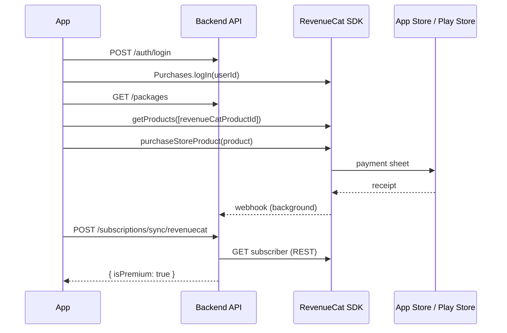

# Premium subscription: package থেকে purchase পর্যন্ত

App developer-এর জন্য গাইড: অ্যাপে plan দেখানো, App Store / Play Store দিয়ে কেনা, backend-এ Premium চালু হওয়া, আর testing থেকে production পর্যন্ত সব ধাপ।

- **Base URL (production):** `https://<api-domain>/api/v1`
- **Base URL (testing):** `http://<server-ip>:5004/api/v1`. Testing server-এ এখনো HTTPS নেই, [নিচে দেখুন](#testing-server-এ-https-নেই)।
- **Payment:** RevenueCat (Stripe আর নেই)
- **Reporting currency:** GBP
- **পুরো API spec:** `/api-docs`

> [!IMPORTANT]
> Login-এর পর RevenueCat-এ ইউজারের backend id দিয়ে `Purchases.logIn(userId)` করতেই হবে। Backend RevenueCat-এর `app_user_id` কে ইউজারের id ধরে নেয়। এটা না করলে কেনা হবে, কিন্তু Premium চালু হবে না।

## সূচিপত্র

1. [পুরো flow এক নজরে](#১-পুরো-flow-এক-নজরে)
2. [একবারের setup](#২-একবারের-setup)
3. [অ্যাপে integration](#৩-অ্যাপে-integration)
4. [Backend API](#৪-backend-api)
5. [Status ও UI](#৫-status-ও-ui)
6. [Testing](#৬-testing)
7. [Production-এ যাওয়ার checklist](#৭-production-এ-যাওয়ার-checklist)
8. [সমস্যা হলে](#৮-সমস্যা-হলে)

---

## ১. পুরো flow এক নজরে

টাকা নেয় store (Apple / Google)। RevenueCat সেটা যাচাই করে। Backend RevenueCat থেকে আসল অবস্থা পড়ে ইউজারকে Premium করে। অ্যাপ কখনো নিজে থেকে "Premium" ধরে নেবে না, সবসময় backend-এর `isPremium` দেখবে।



Webhook আর sync দুটোই একই কাজ করে: RevenueCat থেকে ইউজারের বর্তমান অবস্থা পড়ে save করে। Webhook দেরিতে এলেও অ্যাপের sync call সাথে সাথে Premium চালু করে দেয়।

---

## ২. একবারের setup

এগুলো অ্যাপ কোডের বাইরের কাজ। কে করবে সেটা বন্ধনীতে লেখা।

### Store (App owner)

- **App Store Connect:** একটা subscription group-এ auto-renewable subscription তৈরি করুন, যেমন `premium_monthly`।
- **Google Play Console:** একটা subscription আর তার base plan তৈরি করুন। RevenueCat Play-এর product id কে `subscriptionId:basePlanId` আকারে দেখায়, যেমন `premium:monthly`।

### RevenueCat dashboard (App owner)

- iOS আর Android দুটো app যোগ করুন, store-এর credentials দিন।
- Products import করুন।
- একটা entitlement বানান, যেমন `premium`, আর সব Premium product সেটার সাথে যুক্ত করুন।
- **Integrations → Webhooks:**
  - URL: `https://<api-domain>/api/v1/subscriptions/webhook/revenuecat`
  - Authorization header-এ সেই মান দিন যা backend-এর `REVENUECAT_WEBHOOK_SECRET`-এ আছে।
- **API keys:**
  - অ্যাপে লাগবে প্রতিটা platform-এর **public SDK key**: iOS-এ `appl_…`, Android-এ `goog_…`।
  - Backend-এ লাগবে **secret key** (`sk_…`), যেটা `REVENUECAT_API_KEY`-এ বসবে।

> [!CAUTION]
> `sk_…` key দিয়ে যেকোনো ইউজারের subscription পড়া আর বদলানো যায়। এটা কখনো অ্যাপে রাখবেন না, শুধু backend-এর `.env`-এ থাকবে।

### Backend package (Admin)

অ্যাপ যে plan দেখায় সেগুলো backend-এর `Package`। প্রতিটা package একটা store product-এর সাথে মেলে:

| Field                 | মানে                                                                                         |
| --------------------- | -------------------------------------------------------------------------------------------- |
| `revenueCatProductId` | RevenueCat-এ যে product id দেখায়, হুবহু সেটা। Play-এর ক্ষেত্রে `sub:baseplan`।              |
| `entitlementId`       | যে entitlement এই product চালু করে, যেমন `premium`।                                          |
| `price`, `currency`   | শুধু দেখানোর জন্য (GBP)। আসল দাম store নেয়, তাই অ্যাপে store-এর localized দাম দেখানোই ভালো। |
| `billingCycle`        | `MONTHLY` বা `ANNUAL`                                                                        |

Package তৈরি হয় admin token দিয়ে `POST /packages`-এ, অথবা default monthly plan-এর জন্য `npm run seed:packages` চালিয়ে।

> [!WARNING]
> Seed করা monthly package-এর (`npm run seed:packages`) `revenueCatProductId = premium_monthly` আর `entitlementId = premium` শুধু অনুমান করে বসানো। RevenueCat-এর আসল id জানা হলে admin দিয়ে `PATCH /packages/:id` করে ঠিক করতে হবে, নাহলে store product মিলবে না।

---

## ৩. অ্যাপে integration

উদাহরণ React Native (`react-native-purchases`) আর Flutter (`purchases_flutter`)-এ দেওয়া। আপনার SDK version অনুযায়ী method-এর নাম একবার মিলিয়ে নিন।

### ধাপ ১: App চালু হলে RevenueCat configure

Platform অনুযায়ী public SDK key দিন। শুরুতে `appUserID` দেবেন না, login-এর পর `logIn` করবেন।

```ts
// React Native
import Purchases from "react-native-purchases";
import { Platform } from "react-native";

Purchases.configure({
  apiKey: Platform.OS === "ios" ? "appl_xxx" : "goog_xxx",
});
```

```dart
// Flutter
import 'dart:io';
import 'package:purchases_flutter/purchases_flutter.dart';

await Purchases.configure(
  PurchasesConfiguration(Platform.isIOS ? 'appl_xxx' : 'goog_xxx'),
);
```

### ধাপ ২: Login-এর পর RevenueCat-এ একই user

`POST /auth/login` সফল হলে `GET /profile` থেকে `id` নিয়ে `logIn` করুন। অ্যাপ খোলার সময় ইউজার আগে থেকেই logged in থাকলে তখনও এটা করুন।

```ts
// React Native
const profile = await api.get("/profile"); // { data: { id, ... } }
await Purchases.logIn(profile.data.id);
```

```dart
// Flutter
final profile = await api.get('/profile'); // { data: { id, ... } }
await Purchases.logIn(profile['data']['id']);
```

### ধাপ ৩: Plan দেখানো

`GET /packages` থেকে plan আনুন, তারপর প্রতিটার `revenueCatProductId` দিয়ে store product আনুন। Store-এর দাম (`priceString`) দেখান, কারণ সেটা ইউজারের দেশের currency-তে আসে।

```ts
// React Native
const { data: packages } = await api.get("/packages");
const products = await Purchases.getProducts(
  packages.map(p => p.revenueCatProductId)
);
// match: products.find(pr => pr.identifier === pkg.revenueCatProductId)
```

```dart
// Flutter
final packages = (await api.get('/packages'))['data'] as List;
final products = await Purchases.getProducts(
  packages.map((p) => p['revenueCatProductId'] as String).toList(),
);
// match: products.firstWhere((pr) => pr.identifier == pkg['revenueCatProductId'])
```

কোনো package-এর store product না পাওয়া গেলে বুঝবেন `revenueCatProductId` RevenueCat-এর সাথে মেলেনি। ওই plan লুকিয়ে রাখুন আর admin-কে জানান।

### ধাপ ৪: কেনা, তারপর backend sync

Purchase সফল হলে সাথে সাথে `POST /subscriptions/sync/revenuecat` call করুন। Response-এর `isPremium` দেখেই Premium খুলবেন।

```ts
// React Native
try {
  await Purchases.purchaseStoreProduct(product);
  const { data: sub } = await api.post("/subscriptions/sync/revenuecat");
  if (sub?.isPremium) unlockPremium();
} catch (e) {
  if (!e.userCancelled) showError(e.message);
}
```

```dart
// Flutter
try {
  await Purchases.purchaseStoreProduct(product);
  final sub = (await api.post('/subscriptions/sync/revenuecat'))['data'];
  if (sub != null && sub['isPremium'] == true) unlockPremium();
} on PlatformException catch (e) {
  final code = PurchasesErrorHelper.getErrorCode(e);
  if (code != PurchasesErrorCode.purchaseCancelledError) showError(e.message);
}
```

Sync 502 দিলে RevenueCat সাময়িকভাবে পৌঁছানো যাচ্ছে না। কয়েক সেকেন্ড পর আবার চেষ্টা করুন। Webhook-ও কিছুক্ষণের মধ্যে Premium চালু করে দেবে।

### ধাপ ৫: Premium আছে কিনা জানা

App খোলার সময় আর foreground-এ ফিরলে `GET /subscriptions/my` দেখুন। `data` `null` হলে ইউজার কখনো কেনেননি।

Premium endpoint-এ Premium না থাকলে `403` আসে, message `"This feature is only available for premium users!"`। তখন paywall দেখান।

| Premium লাগে                                                                              | Free (Premium ছাড়াই চলে)                                   |
| ----------------------------------------------------------------------------------------- | ----------------------------------------------------------- |
| symptom, checklist, cost, cycle, document, note, photo, question, supplement, test result | appointment, medication (reminder সহ), journal, data export |

### ধাপ ৬: Restore purchases

Paywall-এ একটা "Restore" বোতাম রাখুন। নতুন ফোন বা reinstall-এর পর এটা লাগে, আর Apple review-এ এটা বাধ্যতামূলক।

```ts
await Purchases.restorePurchases();
await api.post("/subscriptions/sync/revenuecat");
```

### ধাপ ৭: Cancel বা plan বদল

Backend-এ cancel করার কোনো endpoint নেই, subscription store-এই বাতিল হয়। `GET /subscriptions/my`-এর `managementUrl` খুলুন, অথবা SDK-এর `Purchases.showManageSubscriptions()` ব্যবহার করুন। Cancel করার পরও মেয়াদ শেষ (`endDate`) পর্যন্ত Premium থাকে।

### ধাপ ৮: Logout

`POST /auth/logout`-এর পর `Purchases.logOut()` করুন, যাতে একই ফোনে অন্য কেউ login করলে আগের জনের subscription তার নামে না যায়।

---

## ৪. Backend API

সব request-এ `Authorization: Bearer <accessToken>` লাগবে, শুধু webhook ছাড়া।

| Endpoint                                 | কে          | কাজ                                                                                          |
| ---------------------------------------- | ----------- | -------------------------------------------------------------------------------------------- |
| `GET /packages`                          | User, Admin | Plan list, সবচেয়ে সস্তা আগে। Deleted package ইউজার দেখে না।                                 |
| `GET /packages/:id`                      | User, Admin | একটা plan                                                                                    |
| `POST /subscriptions/sync/revenuecat`    | User        | RevenueCat থেকে অবস্থা এনে save করে, তারপর ফেরত দেয়। Purchase বা restore-এর পরে call করবেন। |
| `GET /subscriptions/my`                  | User        | Save করা অবস্থা পড়ে। কখনো না কিনলে `null`।                                                  |
| `POST /subscriptions/test-purchase`      | User        | শুধু QA server-এ: RevenueCat ছাড়াই Premium চালু করে ([Testing](#৬-testing) দেখুন)।          |
| `POST` / `PATCH` / `DELETE /packages`    | Admin       | Plan তৈরি, বদল, soft delete। `PATCH`-এ `{"isDeleted": false}` দিলে deleted plan ফিরে আসে।    |
| `POST /subscriptions/webhook/revenuecat` | RevenueCat  | শুধু RevenueCat call করে, অ্যাপ নয়।                                                         |

### `GET /packages` response

```json
{
  "success": true,
  "message": "Packages fetched successfully!",
  "data": [
    {
      "id": "6b0509e6240dfeb9906d613e",
      "title": "Monthly plan",
      "billingCycle": "MONTHLY",
      "revenueCatProductId": "premium_monthly",
      "entitlementId": "premium",
      "description": ["Monthly membership package that you can subscribe to"],
      "price": 19.99,
      "currency": "gbp",
      "isDeleted": false
    }
  ]
}
```

### `GET /subscriptions/my` ও sync response

```json
{
  "success": true,
  "message": "Subscription fetched successfully!",
  "data": {
    "status": "ACTIVE",
    "isPremium": true,
    "autoRenew": true,
    "endDate": "2026-12-24T10:15:00.000Z",
    "store": "APP_STORE",
    "managementUrl": "https://apps.apple.com/account/subscriptions",
    "package": {
      "id": "6b0509e6240dfeb9906d613e",
      "title": "Monthly plan",
      "billingCycle": "MONTHLY"
    },
    "createdAt": "2026-11-24T10:15:00.000Z"
  }
}
```

---

## ৫. Status ও UI

Premium বলতে শুধু `status: "ACTIVE"` বোঝায়, যেটা `isPremium: true` হিসেবেও আসে।

| Status          | কখন                                        | অ্যাপে কী দেখাবেন                                                       |
| --------------- | ------------------------------------------ | ----------------------------------------------------------------------- |
| `ACTIVE`        | Entitlement চালু, store-এর grace period সহ | Premium খোলা। `autoRenew: false` হলে লিখুন "Premium শেষ হবে {endDate}"। |
| `BILLING_ISSUE` | Payment ব্যর্থ, grace period শেষ           | Premium বন্ধ। "Payment method আপডেট করুন" লিখে `managementUrl` দেখান।   |
| `CANCELLED`     | Refund হয়েছে                              | Premium বন্ধ, paywall দেখান                                             |
| `EXPIRED`       | মেয়াদ শেষ                                 | Premium বন্ধ, "আবার subscribe করুন"                                     |

**Push notification** (type `SUBSCRIPTION`, backend নিজে থেকে পাঠায়):

- "Welcome to Premium!": কেনার পর।
- "Payment failed": grace period শুরু হলে বা Premium বন্ধ হলে।
- "Premium ends in 3 days": auto-renew বন্ধ থাকলে, শেষের ৩ দিন আগে।
- "Your Premium has ended": মেয়াদ শেষে।

Notification tap করলে subscription screen খুলুন।

---

## ৬. Testing

দুই রকম testing আছে। প্রথমটা দ্রুত UI testing-এর জন্য, দ্বিতীয়টা আসল store flow-এর জন্য।

### Testing server-এ HTTPS নেই

Testing server-এর এখনো কোনো `https://` URL নেই। API চলে plain `http://<server-ip>:5004`-এ। এর ফলে তিনটা বিষয় মাথায় রাখতে হবে:

**১. অ্যাপকে `http` চালানোর অনুমতি দিন (শুধু debug / test build-এ)।** Android 9+ আর iOS দুটোই default অবস্থায় plain `http` request বন্ধ করে দেয়।

- **Android:** debug build-এর জন্য `src/debug/res/xml/network_security_config.xml`-এ শুধু testing server-এর IP-র জন্য cleartext চালু করুন, আর debug manifest-এ `android:networkSecurityConfig` দিয়ে যুক্ত করুন।

  ```xml
  <network-security-config>
    <domain-config cleartextTrafficPermitted="true">
      <domain includeSubdomains="false">TESTING_SERVER_IP</domain>
    </domain-config>
  </network-security-config>
  ```

- **iOS:** debug configuration-এর `Info.plist`-এ `NSAppTransportSecurity` → `NSExceptionDomains`-এ testing server-এর জন্য `NSExceptionAllowsInsecureHTTPLoads = YES` দিন। শুধু IP হলে exception কাজ না করলে debug build-এ `NSAllowsArbitraryLoads = YES` দিন।

> [!CAUTION]
> এই exception release / production build-এ যাবে না। Production API `https`-এ চলে। Release build-এ `NSAllowsArbitraryLoads` থাকলে Apple review-এ প্রশ্ন ওঠে।

**২. RevenueCat webhook testing server-এ আসবে না।** Webhook-এর জন্য RevenueCat-এর কাছে পৌঁছানো যায় এমন একটা public URL লাগে, আর একটা `https` URL ব্যবহার করাই নিরাপদ। তাই testing-এর সময় webhook-এর ওপর নির্ভর করবেন না:

- কেনা বা restore-এর পর অ্যাপ নিজেই `POST /subscriptions/sync/revenuecat` call করে ([ধাপ ৪](#ধাপ-৪-কেনা-তারপর-backend-sync))। এতে webhook ছাড়াই Premium চালু হয়ে যায়।
- App খোলার সময় বা subscription screen-এ ঢুকলে একবার sync করুন। Store-এ cancel, renewal বা মেয়াদ শেষ হওয়ার মতো যে পরিবর্তন সাধারণত webhook আনে, সেগুলো তখন ধরা পড়বে।
- Webhook নিজেই পরীক্ষা করতে হলে backend developer সাময়িকভাবে একটা HTTPS tunnel (যেমন `cloudflared tunnel` বা `ngrok`) দিয়ে testing server-এর জন্য public `https` URL বানিয়ে RevenueCat-এ বসাতে পারেন।

**৩. Refresh cookie-র ওপর নির্ভর করবেন না।** Testing server যদি `NODE_ENV=production`-এ চলে, refresh cookie `Secure` হয়, ফলে `http`-এ সেটা ফেরত যায় না। মোবাইল অ্যাপে login-এর সময় `isMobileApp: true` পাঠান, refresh token body থেকে নিন, আর refresh করার সময় `x-refresh-token` header-এ পাঠান। এতে `http` আর `https` দুই জায়গাতেই একইভাবে কাজ করে।

`ENABLE_TEST_PURCHASE` দিয়ে করা backend test purchase ([নিচে ক](#ক-backend-test-purchase-store-বা-revenuecat-ছাড়াই)) RevenueCat বা webhook ছাড়াই চলে, তাই HTTPS না থাকলেও সেটা পুরোপুরি কাজ করে।

### ক. Backend test purchase: store বা RevenueCat ছাড়াই

Premium screen আর premium feature দ্রুত পরীক্ষার জন্য। এটা শুধু সেই server-এ চলে যেখানে `ENABLE_TEST_PURCHASE=true` আর `NODE_ENV` `production` নয়। অন্যথায় `404` আসে।

```http
POST /api/v1/subscriptions/test-purchase
Authorization: Bearer <user accessToken>
Content-Type: application/json

{ "packageId": "<GET /packages থেকে পাওয়া id>" }
```

- ফল: `status: ACTIVE`, `store: "TEST_API"`, মেয়াদ MONTHLY হলে +১ মাস, ANNUAL হলে +১ বছর।
- Payment রেকর্ড তৈরি হয়, কিন্তু `SANDBOX` হিসেবে, তাই revenue-তে গোনা হয় না।
- এটা নিজে থেকে expire হয় না। Free অবস্থা পরীক্ষা করতে নতুন test account ব্যবহার করুন।

### খ. Store sandbox: আসল purchase flow, টাকা কাটে না

**iOS:**

- App Store Connect → Users and Access → Sandbox-এ একটা tester বানান।
- ফোনে Settings → App Store → Sandbox Account-এ login করুন।
- Development build বা TestFlight থেকে কিনুন।
- Sandbox-এ monthly renewal প্রায় ৫ মিনিটে হয়, আর কয়েকবার renew হয়ে নিজে থেকে বন্ধ হয়ে যায়।

**Android:**

- Play Console → Settings → License testing-এ tester-এর Gmail যোগ করুন।
- App internal testing track-এ upload করুন, আর tester সেই link থেকে install করুন।
- Test card দিয়ে কিনুন। "Always approves", "Always declines" দুটোই আছে, তাই billing issue-ও পরীক্ষা করা যায়।
- Renewal প্রায় ৫ মিনিটে হয়।

Sandbox purchase-ও একই webhook আর sync দিয়ে ইউজারকে `ACTIVE` করে। শুধু backend সেগুলোকে `SANDBOX` চিহ্ন দেয়, ফলে admin dashboard-এর revenue বা subscriber সংখ্যায় গোনা হয় না।

### যা যা পরীক্ষা করবেন

- [ ] Login → plan list → store দাম ঠিকঠাক দেখাচ্ছে
- [ ] কেনা → sync → `isPremium: true` → premium feature খুলছে, "Welcome to Premium!" push আসছে
- [ ] Store-এ cancel → sync → `autoRenew: false`, তবুও Premium খোলা
- [ ] মেয়াদ শেষ (sandbox-এ কয়েক মিনিট) → `EXPIRED` → premium endpoint-এ `403` → paywall দেখাচ্ছে
- [ ] App delete করে reinstall → login → Restore → Premium ফিরে আসছে
- [ ] Logout → অন্য account দিয়ে login → সে Premium পাচ্ছে না
- [ ] Android declined card → grace period-এ "Payment failed" push, তারপর `BILLING_ISSUE`
- [ ] Purchase sheet বন্ধ করে দিলে কোনো error দেখাচ্ছে না

---

## ৭. Production-এ যাওয়ার checklist

### Store ও RevenueCat (App owner)

- [ ] Subscription product App Review / Play-তে approved
- [ ] Production API একটা `https://` domain-এ চলছে (testing-এর মতো plain `http` নয়)
- [ ] RevenueCat-এ product → entitlement যুক্ত, webhook URL production API-র `https` URL
- [ ] Webhook-এর Authorization মান production-এর `REVENUECAT_WEBHOOK_SECRET`-এর সাথে মেলে। RevenueCat-এর "Send test event"-এ `200` আসে।

### Backend (Backend / Admin)

- [ ] Server-এর `.env`-এ `NODE_ENV=production` (docker compose এখন এটা `.env` থেকেই নেয়), আর `ENABLE_TEST_PURCHASE` সেট করা নেই
- [ ] `REVENUECAT_API_KEY` = secret key (`sk_…`), `REVENUECAT_WEBHOOK_SECRET` সেট করা
- [ ] প্রতিটা package-এর `revenueCatProductId` আর `entitlementId` RevenueCat-এর আসল id (seed করা `premium_monthly` বদলানো হয়েছে)

### App (App developer)

- [ ] Production build-এ public SDK key (`appl_…`, `goog_…`), কোথাও `sk_…` নেই
- [ ] Login আর app launch দুই জায়গাতেই `Purchases.logIn(userId)`, আর logout-এ `logOut()`
- [ ] Restore বোতাম, privacy policy ও terms-এর link paywall-এ আছে (Apple বাধ্যতামূলক করে)
- [ ] Test-purchase call অ্যাপের production কোডে নেই

প্রথম আসল purchase-এর পর admin dashboard-এ "New subscription" notification আসবে, আর revenue GBP-তে বাড়বে। না এলে নিচের টেবিল দেখুন।

---

## ৮. সমস্যা হলে

| লক্ষণ                                               | কারণ                                                                                                  | সমাধান                                                              |
| --------------------------------------------------- | ----------------------------------------------------------------------------------------------------- | ------------------------------------------------------------------- |
| কেনা হলো, কিন্তু `isPremium: false` বা `data: null` | `Purchases.logIn(userId)` করা হয়নি, তাই RevenueCat-এ কেনাটা anonymous id-তে গেছে                     | Login-এর পর `logIn` করুন, তারপর Restore আর sync                     |
| Plan list-এ store product পাওয়া যাচ্ছে না          | `revenueCatProductId` RevenueCat-এর product id-র সাথে মেলে না, অথবা product এখনো store-এ approved নয় | Admin দিয়ে package-এর id ঠিক করুন                                  |
| Premium আছে কিন্তু `package: null`                  | RevenueCat-এর product id কোনো package-এর সাথে মেলেনি (প্রায়ই Play-এর `sub:baseplan`)                 | Package-এ RevenueCat যে id দেখায় হুবহু সেটা দিন                    |
| Sync `502`                                          | RevenueCat পৌঁছানো যায়নি, বা backend-এর API key ভুল                                                  | আবার চেষ্টা করুন। বারবার হলে backend-এর `REVENUECAT_API_KEY` দেখুন। |
| Premium endpoint `403`                              | Status `ACTIVE` নয়                                                                                   | Sync করুন, না হলে paywall দেখান                                     |
| যেকোনো request `401`                                | Token-এর মেয়াদ শেষ, password বদলেছে বা account block হয়েছে                                          | Refresh করুন। তবুও `401` এলে আবার login করান।                       |
| `test-purchase` `404`                               | Server-এ `ENABLE_TEST_PURCHASE` বন্ধ, অথবা production                                                 | QA server ব্যবহার করুন                                              |
| Admin dashboard-এ sandbox কেনা দেখাচ্ছে না          | ইচ্ছাকৃত: sandbox revenue বা subscriber-এ গোনা হয় না                                                 | কিছু করার নেই                                                       |
